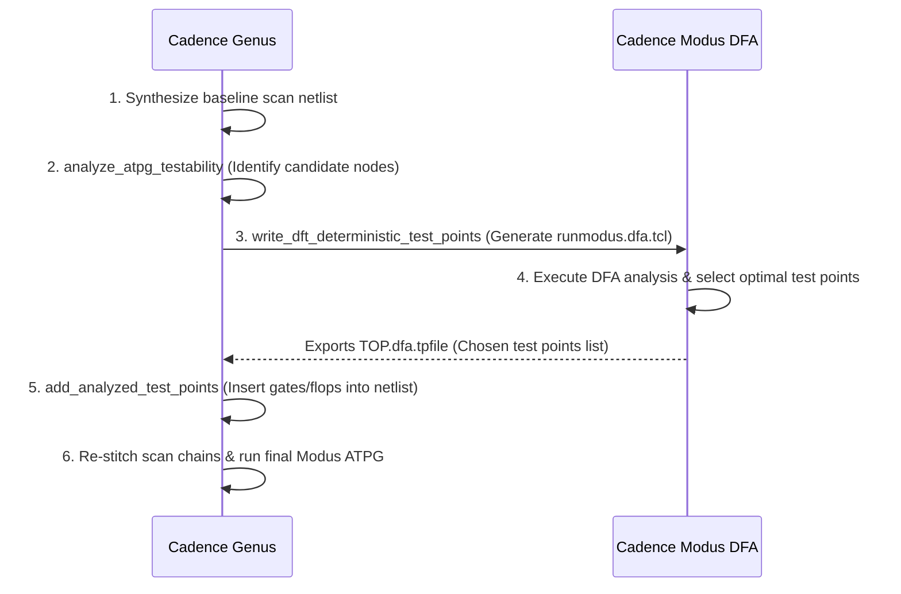

# Stage 3: ATPG Analysis and Deterministic Test Point Insertion (TPI)

Welcome to **Stage 3** of the SOCX DFT flow! In this stage, you will learn how **Cadence Genus** and **Cadence Modus** work in tandem to perform **Deterministic Fault Analysis (DFA)** and insert **Test Points (TPI)** into difficult-to-test logic cones.

---

## 📑 Table of Contents

1. [Why Full-Scan is Sometimes Not Enough](#-why-full-scan-is-sometimes-not-enough)
2. [What are Test Points (Control & Observation Points)?](#-what-are-test-points-control--observation-points)
3. [The 6-Step TPI Workflow](#-the-6-step-tpi-workflow)
4. [How to Run This Stage](#-how-to-run-this-stage)
5. [Line-by-Line Script Breakdown (`scan.tcl`)](#-line-by-line-script-breakdown-scantcl)
6. [Understanding the DFA Script & `.dfa.tpfile`](#-understanding-the-dfa-script--dfatpfile)
7. [Benefits & Hardware Trade-Offs](#-benefits--hardware-trade-offs)
8. [Summary & Key Takeaways](#-summary--key-takeaways)
9. [Next Steps: Moving to Stage 4](#-next-steps-moving-to-stage-4)

---

## 💡 Why Full-Scan is Sometimes Not Enough

Even after all flip-flops are stitched into scan chains, certain combinational logic structures remain stubborn test bottlenecks:

1. **Low Controllability (Deep Logic Cones)**:
   - For example, an AND gate with 16 inputs requires all 16 inputs to be driven to `1` simultaneously to test the output stuck-at-0 fault.
   - Generating a test pattern that satisfies all 16 conditions while simultaneously testing other faults creates severe pattern generation conflicts.
2. **Low Observability (Masked Fault Propagation)**:
   - When a fault occurs deep inside an arithmetic unit (such as ALU carry-propagate chains), the fault effect may have to pass through many levels of XOR/AND logic. If intermediate nodes block the path, the fault cannot reach a scan flip-flop.

These bottlenecks cause ATPG tools to generate **thousands of extra test patterns** or leave faults categorized as **Undetectable (UD)** or **ATPG-Untestable (AU)**.

---

## 🔬 What are Test Points (Control & Observation Points)?

Test Point Insertion (TPI) strategically modifies the gate netlist during synthesis:

### 1. Control Points (CP)
Inserts a test multiplexer or logic gate to directly set an internal net to `0` or `1` during test mode without affecting normal functional operation:

```text
  Functional Signal ────────+
                            │   +---+
                            ├───| 0 |
                                |   |-----> Driven Logic Cone
  Test Constant (0 or 1) ───────| 1 |
                                +---+
                                  │
                             TestPoint_Enable
```

### 2. Observation Points (OP)
Taps an internal high-fanout or deeply buried net and routes it into a dedicated test scan flip-flop (or XOR compression tree):

```text
  Internal Buried Net ──────────────┬────────> Functional Downstream Logic
                                    │
                                    ▼
                          [Dedicated Test SDFF] ───> Stitched into Scan Chain
```

---

## 🔄 The 6-Step TPI Workflow

The interaction between Genus and Modus follows this automated cycle:



---

## 🚀 How to Run This Stage

### Option A: Interactive Tcl Shell
```bash
cd DFT/3_SCAN_WITH_ATPG_ANALYSIS_N_TPI
genus
```
Inside Genus:
```tcl
genus@root:> source scan.tcl
```

### Option B: Batch Mode
```bash
cd DFT/3_SCAN_WITH_ATPG_ANALYSIS_N_TPI
genus -files scan.tcl -log genus_tpi.log
```

---

## 📜 Line-by-Line Script Breakdown (`scan.tcl`)

In [scan.tcl](scan.tcl), the first half executes synthesis and initial scan stitching (identical to Stage 2). The second half executes the DFA and TPI insertion:

### 1. Initial Scan Insertion & Tech Mapping
```tcl
# (Setup, DRC Fix, 80 Scan Chains definition, syn_generic, syn_map)
set_db [current_design] .dft_min_number_of_scan_chains $NUM_SCAN_CHAINS
connect_scan_chains -auto_create
```

### 2. Performing Testability Analysis
```tcl
analyze_atpg_testability -directory $TP_DIR -library $VERILOG_LIB [current_design]
```
- **Explanation**: Genus profiles all combinational logic cones, computing COP (Controllability/Observability Program) probability values to find candidate fault sites that resist ATPG detection.

### 3. Generating Modus DFA Scripts
```tcl
write_dft_deterministic_test_points -library $VERILOG_LIB
```
- **Explanation**: Writes out the DFA setup and script `./test_scripts/runmodus.dfa.tcl` configured specifically for Cadence Modus.

### 4. Running Modus DFA Engine via OS Exec
```tcl
puts "Running Modus analysis..."
exec modus -files ./test_scripts/runmodus.dfa.tcl
```
- **Explanation**: Invokes Cadence Modus in the background. Modus performs deterministic fault simulations and writes the optimal test points into `./test_scripts/${DESIGN_NAME}.dfa.tpfile`.

### 5. Inserting Test Points into Netlist
```tcl
add_analyzed_test_points -input_test_point_file ./test_scripts/${DESIGN_NAME}.dfa.tpfile
check_dft_rules
```
- **Explanation**: Genus reads the `.dfa.tpfile` and physically inserts the control gates and observation flip-flops into the gate netlist. `check_dft_rules` verifies that the newly added test flops satisfy all clock/reset rules.

### 6. Re-Stitching Scan Chains
```tcl
# Re-stitch chains to incorporate new test point flip-flops
connect_scan_chains -auto_create
```
- **Explanation**: Seamlessly integrates the newly added observation flip-flops into the existing 80 scan chains, re-balancing chain lengths.

### 7. Final Optimization & ATPG Test Generation
```tcl
set_db syn_opt_effort $EFFORT
syn_opt

write_netlist > $NETLIST_DIR/${DESIGN_NAME}_Scan_Netlist.v
write_sdc >     $NETLIST_DIR/${DESIGN_NAME}_mapped.sdc
write_dft_atpg -library $VERILOG_LIB -directory $ATPG_DIR -generate_config_file [current_design]

puts "Running Modus ATPG..."
exec modus -files $ATPG_DIR/runmodus.atpg.tcl
```
- Runs incremental timing optimization and generates the final test vectors on the test-point enhanced netlist.

---

## 📁 Understanding the DFA Script & `.dfa.tpfile`

When you explore the generated `test_scripts/` directory:
- **`runmodus.dfa.tcl`**: Modus batch script that builds the test model, measures baseline fault coverage, and calculates test point placement cost functions.
- **`TOP.dfa.tpfile`**: Machine-readable output containing the exact hierarchical net names, gate types, and polarities where control/observation points were inserted.
- **`TOP.noTpFile`**: Contains baseline fault statistics prior to test point insertion for comparison.

---

## ⚖️ Benefits & Hardware Trade-Offs

| Parameter | Without Test Points | With Deterministic TPI | Improvement |
|---|---|---|---|
| **ATPG Pattern Count** | High | **Significantly Reduced** | 20% – 40% fewer test patterns |
| **Fault Coverage** | ~98.5% | **> 99.9%** | Eliminates random-resistant faults |
| **Area Overhead** | 0% | **< 0.5%** | Minimal silicon area addition |
| **ATE Test Time** | Longer | **Faster** | Direct reduction in manufacturing test cost |

---

## 🎯 Summary & Key Takeaways

1. **Test Points** break deep logic cones, making random-resistant faults easily testable.
2. The Cadence **Genus + Modus DFA flow** provides a fully automated, deterministic method for selecting and inserting test points without manual trial-and-error.
3. Scan chains are automatically re-stitched to include observation flip-flops.

---

## ➡️ Next Steps: Moving to Stage 4

Now that our design has high testability, we face another challenge: in a chip package with only a few external test pins, how do we test thousands of flip-flops efficiently?

In **Stage 4 (`4_SCAN_COMPRESSION_ANALYSIS`)**, you will explore **Scan Compression** across multiple compression ratios (60x to 200x) to evaluate test data reduction vs. gate overhead.

👉 **Proceed to Stage 4:** [../4_SCAN_COMPRESSION_ANALYSIS/README.md](../4_SCAN_COMPRESSION_ANALYSIS/README.md)
